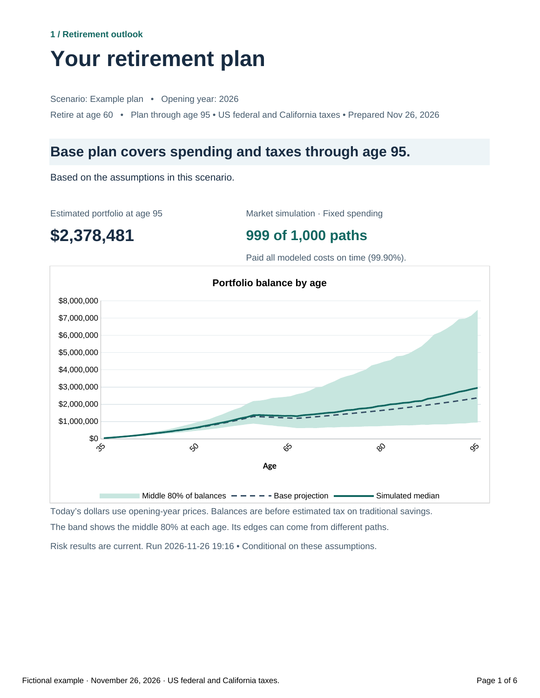
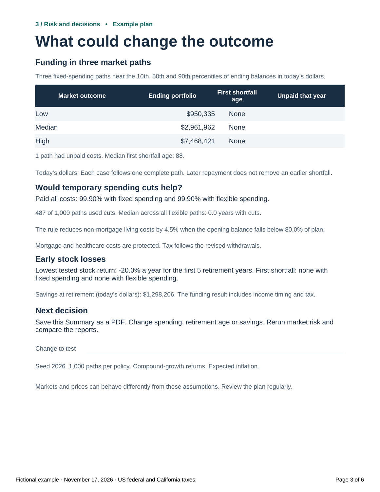
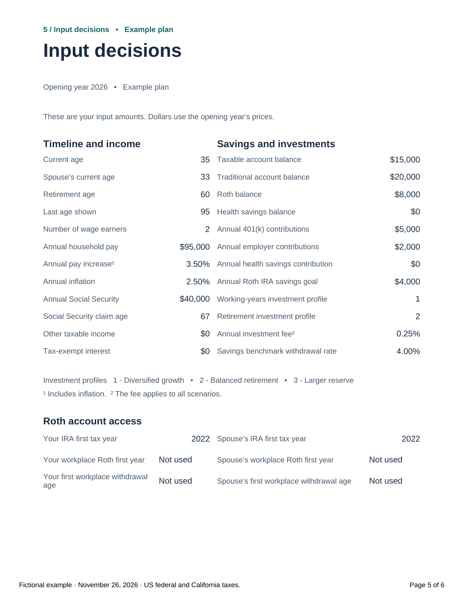

# Retirement planner

## Plan your retirement in Excel.

Test whether income and savings can cover spending and taxes through retirement. Compare retirement ages, budgets and market returns. The model estimates US federal and California taxes for a couple, with an option to model a surviving spouse.

**[Download for Excel for Mac](https://github.com/Jon-275/financial-model/raw/main/workbook/retirement-model.xlsm)** · **[Preview the example report](docs/examples/retirement-plan-example.pdf)** · **[Try the guided example](docs/getting-started.md)**

For educational use. The examples use fictional figures. Results depend on your assumptions. [Scope and limits](docs/model-guide.md#items-to-estimate-separately)

*Actual example report, page 1 of 6. The figures illustrate the model, not an expected outcome for your household.*

## Before you download

| Requirement | What to expect |
| --- | --- |
| Supported environment | Desktop Excel for Mac. Windows and other spreadsheet apps are not verified release targets. |
| File format | Keep the `.xlsm` format when saving your private copy. |
| Macros | Required for **Run market risk**. Follow your organization's macro policy. |
| Base projection | Updates as inputs change with Excel calculation set to **Automatic**. |
| Runtime | Use 100 paired paths while exploring. The documented 1,000-pair example took about 8 minutes; the full age range took 33 minutes. Your Mac and plan affect runtime. |
| Excel for the web | Can display saved results; it does not run the VBA analysis. |
| Coverage | Couples filing jointly, with optional surviving-spouse modeling. US federal and California tax estimates. |

You do not need to install Python or clone this repository to use the workbook. [Versioned downloads and release notes](https://github.com/Jon-275/financial-model/releases)

## Test different scenarios

1. Save a private copy and open **Start Here** in desktop Excel for Mac.
2. Choose **Open Inputs**, select the fictional example and review **Summary**.
3. Compare the provided later-retirement or lower-spending scenario, or change one highlighted input. Review how the base result changes.
4. When ready, review investment assumptions and choose **Run market risk**. Wait for **Risk results are current**, then print **Summary** or save it as a PDF.

Follow the [guided example](docs/getting-started.md), then review the assumptions before entering your own figures.

## What you can explore

| Your question | What the planner shows |
| --- | --- |
| Can income and accessible savings cover the bills? | Annual spending, withdrawals and taxes, including the first shortfall year. |
| What if I retire later or spend less? | Three input scenarios and a six-page report you can save for comparison. |
| What happens when markets change? | Paired fixed/flexible spending paths, balance ranges and separate stress tests. |
| Can I access the accounts when I need them? | Visible account-access schedules and input decision records. |

Preview market risk and the input decision record

*Page 3: compare funding paths, spending cuts and early-loss tests together.*

*Page 5: the report records assumptions alongside the results. This is a report page, not the editable Inputs sheet.*

## Learn more

- [Complete model guide](docs/model-guide.md): household inputs, healthcare, account access and printing.
- [Market risk guide](docs/risk-analysis.md): success rates, balance ranges, spending cuts and assumptions.
- [Workbook schedules](docs/workbook-schedules.md): trace the calculations.
- [Portfolio management](docs/portfolio-management.md): gain and loss harvesting considerations.
- [Get help or report a problem](https://github.com/Jon-275/financial-model/issues/new/choose): use fictional figures; never attach your personal workbook.

## About the project

Created by [Jon](https://github.com/Jon-275). Python builds the workbook. Excel formulas calculate the plan. A VBA macro runs the market tests. Read [how the project works](docs/case-study.md) for the design choices, checks and limits.

For development, use the [build and testing instructions](tests/README.md). Review published tax figures using the [annual tax review](docs/annual-tax-review.md). [Website and release maintenance](docs/publishing.md)

## License

The original workbook, source code and documentation are licensed under [Apache 2.0](LICENSE).
