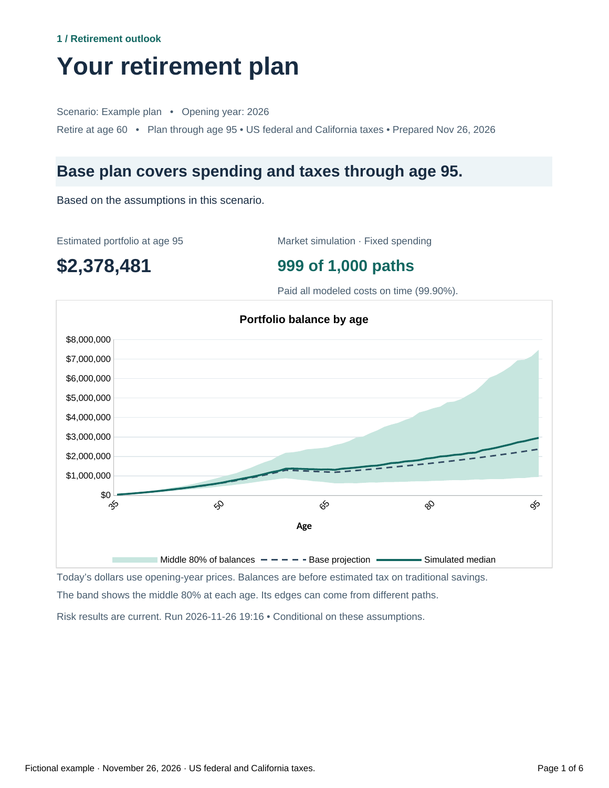

# How I built the retirement planner

By [Jon](https://github.com/Jon-275). [Try the example](getting-started.md) · [View the report](examples/retirement-plan-example.pdf) · [Browse the code](https://github.com/Jon-275/financial-model)

## What I wanted to solve

A retirement plan needs to show whether you can pay each year's bills. A final balance can hide late income, savings you cannot yet access, or higher tax and healthcare costs.

I built the planner to show those details. Users can compare three scenarios, test market returns and save a six-page report with its inputs.

## How it works

Python builds the workbook. Excel formulas calculate income, spending, taxes, withdrawals and balances. A VBA macro runs market trials through those formulas and saves the results.

| Choice | Reason | Code or guide |
| --- | --- | --- |
| Keep calculation sheets visible | Users can trace a result and inspect its formulas. | [Workbook schedules](workbook-schedules.md) |
| Build the workbook with Python | Formulas, layout and packaging can be maintained as code. | [Workbook builder](../tools/author_model.py) |
| Run trials in desktop Excel | The market tests use the workbook's own calculations. This requires macros and takes time. | [VBA runner](../tools/vba/RunMarketRisk.bas) |
| Use the same markets for both spending policies | Users can compare fixed spending with temporary cuts under the same conditions. | [Market tests](risk-analysis.md) |
| Mark old results as out of date | A changed input or failed run should not leave a report that looks current. | [Runner checks](../tests/test_macro_runner_contract.py) |
| Check published files for personal data | Public examples should contain fictional figures. | [Privacy checks](../tools/check_workbook_commit.py) |

## How I check it

The repository includes expected results for sample plans, tests for financial calculations and reports, and recalculation checks in LibreOffice. The [Excel check procedure](../tests/README.md#verify-a-changed-workbook-in-excel) covers opening the file, changing inputs, running and cancelling trials, and comparing saved results with an independent calculation.

Automated checks and native Excel checks serve different purposes. Passing CI does not prove that every Excel action works. See the [test instructions](../tests/README.md) and [CI results](https://github.com/Jon-275/financial-model/actions/workflows/workbook-checks.yml) for the evidence.

## Example output

This report uses fictional figures.

## Limits and next steps

The supported release is for desktop Excel for Mac. Tax estimates cover US federal and California rules for couples, with selected survivor assumptions. Market tests use stated assumptions rather than replaying historical crises. Longer runs can take several minutes. [Full model limits](model-guide.md#items-to-estimate-separately)

Next, I would test the first-use guide with new users. Can they open the example, change one input and explain the result? I have not measured those outcomes yet.
